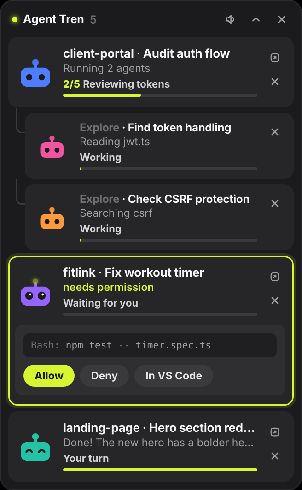
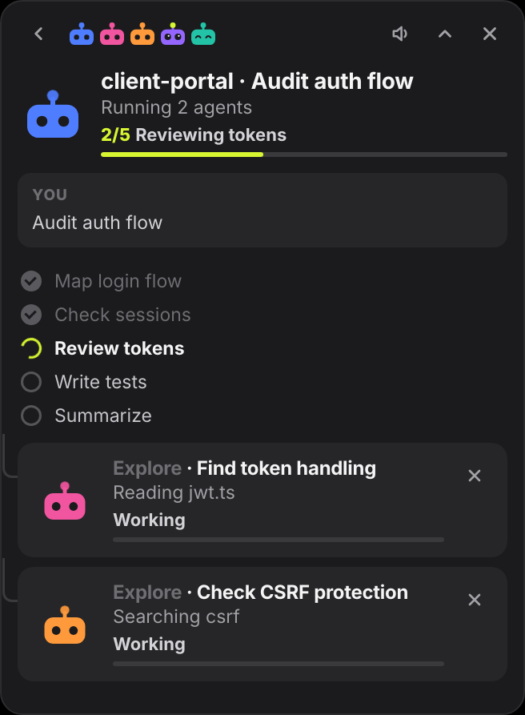

<div align="center">


# Agent Tren

**A tiny always-on-top widget that keeps an eye on your Claude Code sessions.**

See what every session and agent is doing, approve permissions and answer questions — without switching back to VS Code.

[](https://github.com/JureM-student/agent-tren/releases/latest)
[](https://github.com/JureM-student/agent-tren/releases)

[](LICENSE)


&nbsp;&nbsp;


</div>

## Features

- **Every session at a glance** — one card per Claude Code session with what it's doing right now, its to-do progress and its latest message.
- **Agents, live** — when Claude spins up subagents, each one gets its own card under its session, so you can watch them work in parallel.
- **Answer from the widget** — Allow / Deny permission requests and answer Claude's multiple-choice questions right where you are.
- **Knows when you're needed** — the card lights up, plays a soft chime and sends a Windows notification. It also shows when a session is finished, interrupted, or hit the usage limit.
- **Stays out of the way** — lives in the tray, starts with Windows, snaps to any screen corner and never goes off-screen. Toggle it with <kbd>Ctrl</kbd>+<kbd>Shift</kbd>+<kbd>Space</kbd>.
- **One-click setup** — connects to Claude Code automatically; your other settings are left untouched and backed up.

## Install

1. Download **`Agent-Tren-Setup-x.y.z.exe`** from the [latest release](https://github.com/JureM-student/agent-tren/releases/latest).
2. Run it. Windows may show *"Windows protected your PC"* because the app isn't code-signed — click **More info → Run anyway**.
3. When Agent Tren asks to connect to Claude Code, click **Connect**.
4. Reload VS Code (<kbd>Ctrl</kbd>+<kbd>Shift</kbd>+<kbd>P</kbd> → *Reload Window*) or restart Claude Code.

That's it — your sessions appear in the top-right corner.

**Requirements:** Windows 10/11 (64-bit) and [Claude Code](https://claude.com/claude-code) in VS Code or the terminal.

## Usage

| Action | How |
| --- | --- |
| Show / hide | Click the tray icon or press <kbd>Ctrl</kbd>+<kbd>Shift</kbd>+<kbd>Space</kbd> |
| See details (to-dos, messages, terminal) | Click a card |
| Open the project in VS Code | ↗ on a card |
| Move it | Drag the header — drop it near any corner to snap |
| Mute, start with Windows, disconnect | Right-click the tray icon |

## How it works

Agent Tren adds a few [hooks](https://code.claude.com/docs/en/hooks) to `~/.claude/settings.json` that send session events to a small server inside the app (`127.0.0.1:4545`). It also reads Claude Code's local session files to pick up sessions and agents that were already running.

**Everything stays on your computer.** The app only listens on localhost and sends nothing anywhere.

## Troubleshooting

- **Nothing shows up** — right-click the tray icon and check it says *✓ Connected to Claude Code*, then reload VS Code.
- **"Port 4545 is already in use"** — another copy of Agent Tren (or something else) is running on that port.
- **Something looks wrong** — tray icon → *Open event log* shows exactly what Claude Code sent. Attach a few lines to an [issue](https://github.com/JureM-student/agent-tren/issues/new/choose).
- **Claude Code inside WSL** isn't supported yet.

## Uninstall

Right-click the tray icon → **Disconnect from Claude Code**, then uninstall *Agent Tren* from Windows Settings → Apps.

## Build from source

```bash
git clone https://github.com/JureM-student/agent-tren.git
cd agent-tren
npm install
npm start          # run in development
npm run dist       # build the installer into dist/
```

> On Windows, run `npm run dist` once from an **administrator** terminal (or with Developer Mode on) — electron-builder needs it to unpack its signing tools.

Releases are built automatically by GitHub Actions: bump `version` in `package.json`, push to `main`, and the installer is published as a new release.

## License

[MIT](LICENSE) © 2026 Jure M

<sub>Agent Tren is an independent project and is not affiliated with or endorsed by Anthropic.</sub>
